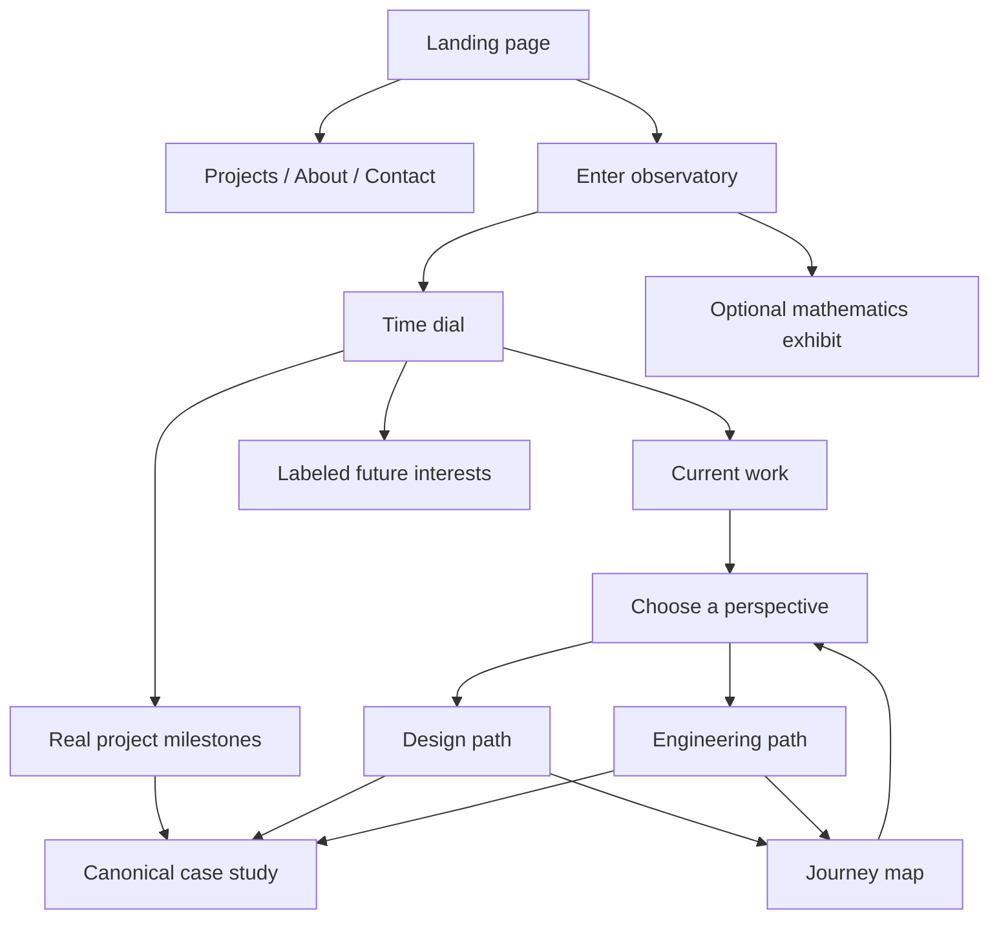
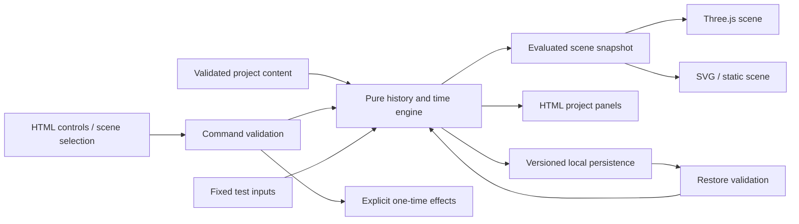

# The Time Observatory

> A portfolio you can rewind, explore, and branch into alternative histories.

**Document type:** Product, experience, mathematics, and engineering plan  
**Status:** Proposed; no implementation is implied  
**Prepared:** 11 October 2026  
**Working name:** The Time Observatory; name availability has not been checked  
**Intended implementation:** A separate portfolio project, with a potentially reusable time-and-history engine

This document is stored in the VisualGuard workspace for planning convenience. The proposed application is a separate product. VisualGuard can later test its rendered output. File trees, APIs, routes, commands, budgets, and milestones below are proposals, not existing functionality.

## Contents

1. [Product vision](#1-product-vision)
2. [Audience and success criteria](#2-audience-and-success-criteria)
3. [Scope and release boundaries](#3-scope-and-release-boundaries)
4. [Visitor journeys](#4-visitor-journeys)
5. [Information architecture](#5-information-architecture)
6. [Art direction and interface](#6-art-direction-and-interface)
7. [Scene and interaction specifications](#7-scene-and-interaction-specifications)
8. [The three kinds of time](#8-the-three-kinds-of-time)
9. [Mathematical models](#9-mathematical-models)
10. [History, branching, and causality](#10-history-branching-and-causality)
11. [Application architecture](#11-application-architecture)
12. [Proposed modules and responsibilities](#12-proposed-modules-and-responsibilities)
13. [Content and asset model](#13-content-and-asset-model)
14. [State, persistence, and sharing](#14-state-persistence-and-sharing)
15. [Accessibility and alternative experiences](#15-accessibility-and-alternative-experiences)
16. [Mobile and browser strategy](#16-mobile-and-browser-strategy)
17. [Performance and resource budgets](#17-performance-and-resource-budgets)
18. [Audio and motion direction](#18-audio-and-motion-direction)
19. [Testing and VisualGuard integration](#19-testing-and-visualguard-integration)
20. [Delivery roadmap](#20-delivery-roadmap)
21. [Prioritized implementation backlog](#21-prioritized-implementation-backlog)
22. [Deployment and operations](#22-deployment-and-operations)
23. [Open-source strategy](#23-open-source-strategy)
24. [Risks and fallback decisions](#24-risks-and-fallback-decisions)
25. [Launch acceptance checklist](#25-launch-acceptance-checklist)
26. [Decisions and inputs still needed](#26-decisions-and-inputs-still-needed)
27. [First implementation session](#27-first-implementation-session)
28. [Reference reading](#28-reference-reading)

## 1. Product vision

Build an interactive observatory in which visitors explore the developer's work through time. The central interaction is a clock-like instrument that changes the state of the experience. Finished projects can be traced back to earlier prototypes. Visitor decisions form a history that can be revisited and branched.

The central promise is:

> You can revisit an earlier choice, choose differently, and see another version of your journey without losing the first one.

The portfolio must accomplish two jobs together:

- Explain who the developer is, what they have built, and how to contact them.
- Demonstrate careful engineering through reproducible animation, state restoration, mathematical interaction, and a distinctive presentation.

### 1.1 What makes the concept substantive

The theme affects application behavior. Time is a real application input. History is stored and reconstructed. Branches have defined ancestry. Mathematical parameters change visible outcomes. Project milestones contain real evidence.

The experience should remain interesting after the visitor understands the visual effect, because they can inspect how a project developed and experiment with the underlying mechanisms.

### 1.2 Product principles

1. **Make the work easy to find.** Project pages, résumé, and contact links are always available.
2. **Give each effect a purpose.** An effect should explain a project, expose a relationship, or communicate time.
3. **Make interactions reversible.** Visitors can return, reset, and explore alternatives.
4. **Keep essential content independent of the renderer.** The portfolio remains useful without WebGL.
5. **Distinguish fact from fiction.** Career milestones are real; alternative narratives and future possibilities are labeled.
6. **Treat mathematical explanations as part of the experience.** Offer a simple explanation first and equations on request.
7. **Make the engine inspectable.** A development panel can reveal time, branch, event history, and scene state.

### 1.3 Non-goals

The first release is not an open-world game, a physically complete relativity simulator, a general-purpose game engine, or a multiplayer experience. It does not require accounts, a CMS, a database, live GitHub data, or an AI service.

Automatically generated alternative careers, fabricated historical work, and invented project metrics are outside the concept. The application can explain alternatives without claiming they happened.

## 2. Audience and success criteria

| Visitor | Main question | Experience that answers it |
| --- | --- | --- |
| Recruiter or hiring manager | What can this person build? | Immediate introduction, selected projects, role, outcomes, résumé |
| Engineering lead | How does this person think? | Project evolution, tradeoffs, architecture notes, source links |
| Potential client | Can this person solve my problem? | Clear problem statements, relevant examples, contact path |
| Creative developer | How does this work? | Optional mathematics panels and a technical walkthrough |
| Casual visitor | What happens if I change time? | A guided, reversible exploration with a satisfying reveal |

### 2.1 Proposed usability targets

These are validation targets, not measured outcomes:

- A first-time visitor can identify the developer's role without interacting with the scene.
- A visitor can open a project or contact link within two direct actions from the landing page.
- A visitor can find the direct portfolio mode immediately, including on a phone.
- In an initial five-person moderated test, at least four participants can pause, rewind, and return to their previous branch without intervention.
- All tested participants can reach a project and contact information without completing a puzzle.
- A visitor can explain the difference between a real project milestone and an imagined future direction.

Five-person testing is an early design signal, not proof of general usability or accessibility. Record confusion and revise before increasing visual complexity.

### 2.2 Quality targets

- Canonical checkpoints reconstruct the same logical state from the same inputs.
- Visual comparisons run in a pinned rendering environment; cross-device pixels are not assumed identical.
- Keyboard navigation, reduced motion, touch input, and a no-WebGL experience are designed before launch.
- Broken assets and interrupted storage do not block project reading.
- No visitor information is required to use the experience.

## 3. Scope and release boundaries

Use three scope levels so the advanced concept has a realistic path to completion.

| Capability | Playable prototype | Public v1 | Later experiments |
| --- | --- | --- | --- |
| Direct portfolio | Introduction and one project | Three evidence-backed projects, about, résumé, contact | Additional case studies |
| Observatory | One gray-box scene | Polished chamber with restrained effects | Additional connected rooms |
| Time controls | Pause, play, seek, reverse | Keyboard/touch support, labeled checkpoints | Authored time distortion zones |
| Project evolution | One project, two milestones | Three projects with verified milestones | More historical artifacts |
| History | One branch point | Branch switching, rewind, reset, reload recovery | More authored branches |
| Mathematics | One Lissajous interaction | Explained and accessible signature interaction | Relativity room and further exhibits |
| Fictional causality | Not required | One small authored payoff if core work passes | Full closed-loop narrative |
| Sharing | Stable project URLs | Project/milestone links | Validated journey replay links |
| Rendering alternatives | HTML and basic SVG | Full/reduced/static modes | Additional quality profiles |
| Audio | None | Optional only if quality gates are met | Spatial sound and adaptive score |
| Reusable package | Internal pure module | Documented internal boundary | Extracted public engine after validation |

Public v1 should contain one convincing example of branching and one mathematical interaction. The relativity room is a planned expansion, not a dependency for finishing the portfolio.

### 3.1 Scope-cut order

If schedule or performance slips, cut ambient audio, post-processing, the fictional loop, and additional rooms first. Keep the direct portfolio, one coherent time interaction, accessibility, and deterministic reconstruction.

## 4. Visitor journeys

### 4.1 The practical visit: roughly 30 seconds

1. The landing page immediately states the developer's name, role, and focus.
2. The visitor chooses “View projects.”
3. They see three concise project summaries and open one.
4. They inspect the problem, contribution, evidence, and source/demo links.
5. They open the résumé or contact link.

No animation completion, sound, puzzle, or large scene download is required.

### 4.2 The guided visit: roughly two to three minutes

1. The visitor chooses “Enter the observatory.” A lightweight preview remains visible while assets load.
2. The time dial pulses once and presents a short instruction: “Move backward to see where this began.”
3. Moving to an earlier milestone reveals a real prototype artifact beside the current result.
4. The visitor chooses a perspective: “Explore the design” or “Explore the engineering.”
5. A branch appears in the journey map. Each path presents different evidence from the same real project.
6. They return to the choice and select the other perspective. Both histories remain inspectable.
7. The path ends at a project summary and contact action.

The timings are design hypotheses. Visitors can move directly between checkpoints.

### 4.3 The curious visit: five minutes or more

The visitor experiments with frequency ratios, inspects the branch map, opens the explanation drawer, and reads how the engine reconstructs earlier states. Later releases add the relativity room and fictional causal loop.

### 4.4 The return visit

Offer “Continue local journey” and “Start again” if compatible saved state exists. Never silently restore a confusing view without a clear way home. If the content has changed, retain preferences but start a fresh compatible journey and explain the reset.

## 5. Information architecture

Proposed routes belong to the new project:

| Route | Purpose | Works without immersive rendering? |
| --- | --- | --- |
| `/` | Introduction, featured projects, entry into the observatory | Yes |
| `/projects` | Direct project index | Yes |
| `/projects/[slug]` | Canonical case study and milestones | Yes |
| `/about` | Biography, approach, selected experience | Yes |
| `/lab` | Mathematical exhibits and implementation explanations | Yes, with static explanations |
| `/observatory` | Interactive scene and journey controls | Static/HTML fallback |
| `/contact` | Contact choices and résumé link | Yes |

Use the canonical project route for search indexing and shared previews. A scene location should link back to that route. Keep controls for Projects, Journey, Motion, and Exit visible within the immersive experience.



## 6. Art direction and interface

### 6.1 Visual language

Use a precise instrument aesthetic: orbital rings, engraved ticks, fine trajectories, restrained light, and readable editorial typography. Favor one central mechanism over a dense field of unrelated effects.

Suggested starting palette, subject to contrast checks:

| Role | Initial color | Usage |
| --- | --- | --- |
| Background | `#080C14` | Observatory surroundings |
| Surface | `#151D2B` | Content panels |
| Main text | `#F2F5FA` | Headings and body text |
| Secondary text | `#B5C1D1` | Supporting explanation |
| Past | `#F4BF75` | Historical milestones |
| Present | `#76DFD1` | Active selection |
| Possible future | `#B7A2F8` | Speculative directions |

Color always accompanies a label, shape, or icon. Exact contrast must be measured against actual backgrounds, including translucent surfaces.

Use a highly readable body face, a restrained display face if needed, and tabular numerals for time. Self-host a minimal font subset with an appropriate license. Keep long reading in HTML panels rather than on moving 3D surfaces.

### 6.2 Layout sketch

```text
┌───────────────────────────────────────────────────────────────┐
│ Name / role       Projects   Journey   Motion settings   Exit │
├───────────────────────────────────────────────────────────────┤
│                                                               │
│             Observatory / selected project artifact           │
│                                                               │
│     Historical preview                    Current preview     │
│                                                               │
├───────────────────────────────────────────────────────────────┤
│ Earlier milestone ◀───── time / milestone dial ─────▶ Current │
│ [Reverse] [Pause] [Play]     [Previous] [Next]     [Explain]    │
├───────────────────────────────────────────────────────────────┤
│ Selected project: problem, contribution, result, open project │
└───────────────────────────────────────────────────────────────┘
```

On narrow screens, replace the circular dial with a horizontal range input and checkpoint buttons. Place the project summary before decorative content in reading order.

### 6.3 Copy guidelines

- Prefer “Return to your choice” over unexplained vocabulary such as “restore causal node.”
- Display the selected project and milestone in plain language.
- Show “Future interest” on speculative work.
- Explain surprising behavior immediately after it happens.
- Give every immersive action a direct alternative.

## 7. Scene and interaction specifications

### 7.1 Observatory entrance

**Purpose:** Introduce the developer and the time-control concept.

**Inputs:** Enter, view projects, motion preference, keyboard focus.

**Output:** A simple scene with a time instrument and three project markers.

**Behavior:** Load essential text first. Entering starts a brief optional transition; skipping lands at the same checkpoint. A failed renderer reveals the static illustration and normal project list.

**Acceptance:** A visitor can open a project while the scene is still loading. Retry never removes working navigation.

### 7.2 Project evolution chamber

**Purpose:** Connect the current work to earlier decisions and artifacts.

Each project has discrete, authored milestones. At a selected milestone show a date or honest approximate period, status, artifact, short explanation, and evidence link. Interpolation between milestones is presentation only; do not invent intermediate historical screenshots.

For VisualGuard, possible material includes the original comparison workflow, report evolution, reliability improvements, and verified current behavior. Select actual artifacts during content preparation rather than reconstructing unsupported history.

**Acceptance:** Selecting the same milestone by dial, keyboard, or direct link displays the same content. Missing historical assets produce a labeled textual milestone rather than a fabricated image.

### 7.3 Project signatures

**Purpose:** Introduce mathematical play tied to each project's identity.

Show one Lissajous pattern with two discrete frequency controls and an optional phase control. Offer a small set of understandable ratios rather than arbitrary precision. Alignment activates a project highlight, but “Open project” is always available.

**Acceptance:** Controls work with keyboard and touch. The static explanation shows the same parameters. Success does not depend on a subpixel judgment or a timed gesture.

### 7.4 Branch chamber

**Purpose:** Make alternative exploration tangible.

At one authored decision, offer two perspectives on the same project. The selected path creates a branch marker. Returning to the decision restores its pre-choice state. A different choice creates a sibling branch and retains the original.

**Acceptance:** Switching between branches restores the correct selection and content. Repeating an input does not accidentally duplicate a branch. The full explanation is also accessible as a normal article.

### 7.5 Frozen scene inspection

**Purpose:** Let visitors examine a moment.

Pausing freezes scene-time animation. The visitor may still open panels and move an inspection camera within limits. Camera movement does not advance simulation time and still requests renderer updates.

**Acceptance:** A frozen particle stays at its world position while the camera changes. Reduced-motion mode offers fixed viewpoints instead of continuous camera travel.

### 7.6 Relativity room: expansion

**Purpose:** Offer an explicit mathematical experiment.

Two labeled clocks display elapsed station coordinate time and simulated traveler proper time. The visitor selects a speed, runs a fixed interval, and compares readings. A static table and explanation provide the same information without animation.

**Acceptance:** Numerical results match the specified formula. Rewinding restores the recorded experiment; it does not suggest that physical proper time becomes negative.

### 7.7 Fictional causal loop: expansion

**Purpose:** Deliver a memorable narrative payoff.

A visitor sees a predetermined “message from the future.” Later, the story offers choices authored to acknowledge or complete that message. Treat this as a fictional scripted loop, not a prediction of unconstrained future input.

An alternative design records the visitor's first message and reveals it on a second pass. Explain the replay framing so the behavior feels intentional.

**Acceptance:** All permitted paths have coherent outcomes. No branch claims to have predicted free text before it existed. The reveal can be skipped and read in text form.

## 8. The three kinds of time

Do not implement every feature with a single overloaded timestamp.

| Time domain | Representation | Purpose | Reversible? |
| --- | --- | --- | --- |
| Project history | Milestone IDs plus real dates/periods | Describes actual work | Selection can move backward; history is unchanged |
| Scene time | Bounded numeric seconds within a scene | Drives animation and demonstrations | Yes, by evaluation at another time |
| Visitor history | Ordered event sequence and branch ancestry | Describes choices and navigation | Yes, by reconstructing a prefix |

Wall-clock time measures elapsed browser time between updates. It is not the authoritative source for project dates or replay state.

### 8.1 Clock contract

Proposed controls:

- `play(rate)`: start scene-time progression at a defined signed rate.
- `pause()`: stop progression without preventing interaction.
- `seek(seconds)`: move directly to a bounded scene time.
- `setRate(rate)`: set one of a small number of supported rates.
- `step(seconds)`: inspect a controlled interval while paused.
- `resetScene()`: restore the authored start checkpoint.

Suggested initial rates: `-2`, `-1`, `-0.5`, `0.5`, `1`, and `2`. A separate paused state avoids ambiguity between zero speed and stored playback preference.

Clamp at scene boundaries. Automatically pause at an end rather than silently wrapping into another chapter. Resuming a backgrounded tab starts from the stored scene time; it does not fast-forward through the absence.

### 8.2 Rendering contract

```text
logicalState = reconstruct(branchId, historyCursor)
sceneSnapshot = evaluateScene(sceneTime, logicalState, contentVersion, seed)
render(sceneSnapshot, cameraState, qualityProfile)
```

Camera pose and quality are rendering inputs. They do not change the factual milestone or branch decision. A saved viewpoint can be an explicit navigation event; per-frame pointer movement is not recorded.

Keep exact integer/order-based logical state separate from floating-point animation values. CPU evaluation should be reproducible within stated tolerances. GPU output is compared under controlled conditions rather than promised to be bit-identical on every machine.

## 9. Mathematical models

### 9.1 Time-driven motion

An object's position is evaluated from scene time rather than repeatedly accumulated from its previous position:

\[
\mathbf{p}(t)=\left(A\cos(\omega t+\phi),\ B\sin(\omega t+\phi),\ z_0\right).
\]

Seeking to an earlier time evaluates the function again. There is no numerical attempt to undo hundreds of prior animation frames.

For a transition over an interval, normalize progress:

\[
u=\operatorname{clamp}\left(\frac{t-t_0}{t_1-t_0},0,1\right),
\qquad s(u)=3u^2-2u^3.
\]

Require `t1 > t0`; validate invalid intervals before rendering. Use `s(u)` to interpolate positions, opacity, or a simple camera path. A direct seek produces the same evaluated state as playback reaching that time.

### 9.2 Lissajous signatures

Use the model:

\[
x(t)=A\sin(a\omega_0 t+\phi),\qquad
y(t)=B\sin(b\omega_0 t).
\]

Choose positive integer `a` and `b`, for example `(1,2)`, `(2,3)`, and `(3,4)`. A period that repeats both components is:

\[
T=\frac{2\pi}{\omega_0\gcd(a,b)}.
\]

This permits predictable loop lengths and meaningful controls. Sample curve geometry once when parameters change; animate a marker or reveal along it using scene time. The general family and frequency-ratio behavior are described in [Wolfram MathWorld's Lissajous Curve reference](https://mathworld.wolfram.com/LissajousCurve.html).

The interaction's success condition should compare chosen parameters with authored target parameters, accounting for any deliberately accepted symmetries. Do not make success depend on image recognition.

### 9.3 Deterministic particles

Assign each particle's initial parameters using a seeded generator indexed by stable particle ID. Evaluate position from those parameters and time. Do not call an uncontrolled random generator during each frame.

Changing quality may reduce the number of visible particles, but common particle IDs retain their motion. Keep particles decorative so reduced quality does not remove information.

### 9.4 Relativity demonstration

For constant speed in a selected inertial station frame:

\[
\beta=\frac{v}{c},\qquad
\gamma=\frac{1}{\sqrt{1-\beta^2}},\qquad
\Delta\tau=\Delta t\sqrt{1-\beta^2}.
\]

In the exhibit, `beta` is dimensionless and the clocks use simulated seconds. Limit the control to `0 <= beta <= 0.99` and state that the upper limit is an interface choice. Do not offer `beta = 1`, where the displayed expression becomes singular for gamma.

Example checkpoints for ten station seconds:

| Speed | Traveler elapsed time, approximately |
| --- | --- |
| `0c` | `10.00 s` |
| `0.6c` | `8.00 s` |
| `0.8c` | `6.00 s` |
| `0.99c` | `1.41 s` |

Explain that these readings are compared using the chosen frame, not a complete simulation of how signals visually arrive. Relative clock-rate comparisons are frame-dependent; this exhibit is not a full twin-paradox, acceleration, gravitational, or faster-than-light model. See [Einstein Online's explanation of time dilation](https://www.einstein-online.info/en/explandict/time-dilation/).

For the initial exhibit, changing speed resets or begins a new trial. If variable-speed experiments are later added, store piecewise speed segments and integrate proper time across them. Do not multiply total elapsed time by the most recently selected speed factor.

### 9.5 Branch geometry

History is a rooted tree: every branch has at most one parent, and v1 has no branch merging. Assign branch positions with a stable layout based on ancestry and creation order. Render edges as simple curves for readability.

The visual map can curve or fold, but its underlying ancestry remains unambiguous. Decorative timeline crossings must not look like actual merge points.

### 9.6 Models to defer

Defer physically simulated double pendulums, arbitrary N-body systems, and full black-hole lensing. They create additional stability, explanation, and performance work. If added, record or recompute trajectories from checkpoints using a defined solver; running a dissipative integrator with a negative delta is not a reliable undo mechanism.

## 10. History, branching, and causality

### 10.1 Event categories

**Durable logical events:** project selected, milestone selected, perspective chosen, exhibit parameters committed, authored checkpoint entered.

**Transient state:** pointer hover, active drag position, loading progress, current focus, uncommitted slider input, camera interpolation.

**Effects:** sound playback, optional analytics, storage writes, external navigation. These are handled separately from reconstruction.

Scrubbing emits preview state while dragging and commits one meaningful navigation event on release. Avoid storing thousands of pointer updates.

### 10.2 Proposed event envelope

```ts
type JourneyEvent = {
  schemaVersion: 1;
  id: string;
  branchId: string;
  sequence: number;
  sceneId: string;
  sceneTime: number;
  payload: JourneyAction; // A validated discriminated union.
};

type Branch = {
  id: string;
  parentId: string | null;
  forkAtEventId: string | null;
  label: string;
  localEventIds: string[];
};
```

`sequence` and branch ancestry determine replay order. `sceneTime` is descriptive context and can move backward; sorting events by scene time would corrupt the visitor's history.

Use stable IDs assigned when commands are accepted. Pure reducers never generate IDs, read the current date, or perform network calls. TypeScript types do not replace runtime validation of persisted or shared input.

### 10.3 Reconstruction algorithm

1. Resolve the active branch's ancestor path.
2. Include each ancestor's effective event prefix only through the relevant fork event.
3. Append the current branch's local events through the selected history cursor.
4. Validate the ordered list against the compatible content and schema versions.
5. Apply the pure reducer from the initial logical state, or from a compatible checkpoint.
6. Evaluate the scene using that state and the selected scene time.

A checkpoint contains the reduced logical state plus the exact effective-history prefix identity and engine/content versions. It is a cache, not authoritative history. A checkpoint from a sibling branch must never be reused merely because the numeric cursor matches.

### 10.4 Fork policy

When a visitor rewinds history and makes a new durable choice, create a new branch from the selected event prefix. Preserve the previous future as its existing branch. Switching branches is different from creating one.

Apply initial limits of 20 branches and 500 durable events per local journey. These are product limits to validate in testing. At the limit, explain the situation and offer export or reset; never silently drop history. v1 does not merge branches.

### 10.5 Replay invariants

- Reconstructing the same valid prefix produces the same logical state.
- A sibling branch cannot mutate its parent's stored events.
- A branch cannot reference itself or a descendant as its parent.
- Events excluded by a fork cannot affect the new branch.
- Reconstruction never sends contact messages, reopens external URLs, emits analytics, or plays past sounds.
- Rewinding scene time alone does not delete visitor choices.
- Rewinding visitor history restores choices; it is a separate explicit control.

Label the controls accordingly: “Scene time” and “Your journey.” This distinction must be visible in the UI, not hidden in technical documentation.

## 11. Application architecture

### 11.1 Recommended starting stack

| Layer | Proposed choice | Reason and constraint |
| --- | --- | --- |
| Application shell | Next.js with TypeScript | Reuse familiar tooling; render portfolio content independently of canvas |
| Primary interface | Semantic HTML and CSS | Reading, controls, keyboard support, resilient navigation |
| 3D renderer | Three.js through React Three Fiber | Scene composition integrated with React |
| Simple diagrams | SVG | Timeline map and mathematical views remain understandable without WebGL |
| State engine | Small framework-independent TypeScript module | Test history and time without mounting a UI |
| Content | Typed local records with Markdown for long text | Versioned authoring without a CMS dependency |
| Persistence | Small validated local journey record | No account/server requirement |
| Unit/property tests | Vitest and an optional property-testing library | Validate invariants and mathematical functions |
| Browser tests | Playwright | Test navigation, controls, fallback, and restoration |
| Visual regression | VisualGuard with deterministic checkpoints | Review appearance changes with the existing project |

Next.js supports dividing server-rendered content and interactive client components; keep that boundary narrow rather than putting the entire portfolio inside one client-only scene. [Next.js server and client component documentation](https://nextjs.org/docs/app/getting-started/server-and-client-components)

Select compatible stable dependency versions at implementation time and record them in the lockfile. React Three Fiber's installation guidance explicitly requires compatible React/Fiber majors. Do not copy a prerelease example without checking the installed API. [React Three Fiber installation documentation](https://r3f.docs.pmnd.rs/getting-started/installation)

Avoid adding a second animation scheduler for scene objects. CSS transitions can serve ordinary panels, but scene-time animation needs one authority. Add helper libraries only for specific validated needs.

### 11.2 Data flow



### 11.3 Server/client boundary

Server/static responsibilities: project pages, metadata, content validation during build, static illustrations, résumé links, and asset manifests.

Client responsibilities: time controls, state reconstruction, input handling, renderer loading, optional audio, and local persistence.

Use an error boundary around the immersive client area. An exception in a shader or asset loader must not remove the HTML navigation or case study content.

## 12. Proposed modules and responsibilities

This is the proposed new repository layout. Keep the engine internal initially; packaging can follow once the boundary survives real use.

```text
time-observatory/
  src/
    app/
      layout.tsx                 Shared HTML shell, metadata, navigation
      page.tsx                   Introduction and direct entry points
      projects/page.tsx          Project index
      projects/[slug]/page.tsx   Canonical case studies
      about/page.tsx             Biography and working approach
      lab/page.tsx               Math explanations and experiments
      contact/page.tsx           Contact and resume links
      observatory/page.tsx       Shell around the client experience
    components/
      controls/                 Accessible time and checkpoint controls
      content/                  Shared case-study components
      journey-map/              SVG map and equivalent HTML list
      fallback/                 Static and reduced-mode presentation
    engine/
      types.ts                  Event, state, branch, and clock contracts
      clock.ts                  Bounded time and playback controls
      commands.ts               Validation and event creation
      reducer.ts                Pure logical state transitions
      history.ts                Effective branch prefixes and cursors
      replay.ts                 Reconstruction and checkpoint lookup
      branches.ts               Fork validation and branch creation
      evaluate.ts               Logical state and time to scene snapshot
      serialization.ts          Runtime validation and format migrations
      random.ts                 Stable seeded parameters
    math/
      interpolation.ts          Normalization and easing functions
      lissajous.ts              Curve sampling and periods
      relativity.ts             Clock calculations for later exhibit
    experience/
      ExperienceRoot.tsx        Client integration and error boundary
      SceneHost.tsx             Renderer lifecycle and mode selection
      scenes/                   Authored scenes using evaluated snapshots
      materials/                Minimal custom materials when justified
      audio/                    Explicit sound lifecycle and mute state
      quality.ts                Capability profile and downgrade policy
      test-bridge.ts            Test-build-only deterministic controls
    content/
      projects/                 Verified case-study data and text
      scenes/                   Scene ranges, transitions, choices
      exhibits/                 Math explanations and parameter limits
    persistence/
      journey-store.ts          Versioned local journey storage
      preferences.ts            Motion, quality, and audio preferences
      share-codec.ts            Later compact replay-link support
  public/
    images/                     Screenshots and static fallbacks
    models/                     Optimized scene assets if needed
    audio/                      Optional licensed audio
    fonts/                      Minimal licensed font files
    resume.pdf                  Approved resume
  tests/
    unit/                       Clock, reducers, equations, serialization
    properties/                 Replay and branch invariants
    e2e/                        Real visitor workflows
    visual/                     Checkpoint scenarios and references
    fixtures/                   Fixed seeds, content, event histories
  docs/
    architecture.md             Implementation decisions
    authoring.md                 Adding projects and scenes
    mathematics.md              Models and their limits
    accessibility.md            Modes and manual test notes
    asset-licenses.md            Attribution and redistribution rights
```

The renderer should consume scene snapshots rather than interpreting raw events itself. This keeps the SVG and 3D views consistent and makes tests useful without a GPU.

## 13. Content and asset model

### 13.1 Project record

Each project needs:

- Stable ID, slug, title, short summary, and status.
- Problem, audience, personal contribution, constraints, and tradeoffs.
- Technologies only where they explain implementation choices.
- Results supported by evidence; label qualitative observations clearly.
- Repository/demo links and their availability status.
- Milestones with a date or approximate period, description, artifact, and evidence.
- Mathematical signature parameters and display colors.
- Image descriptions and static fallback assets.

Keep factual content separate from fictional narration. Changing an exhibit's dramatic copy must not alter the project's factual record.

### 13.2 Milestone example

```ts
type ProjectMilestone = {
  id: string;
  periodLabel: string; // Can honestly say "Early prototype".
  occurredAt?: string; // ISO date only when known.
  title: string;
  explanation: string;
  evidenceUrl?: string;
  artifact?: {
    src: string;
    alt: string;
    provenance: "original" | "reconstruction";
  };
};
```

If a reconstruction is ever used, label it in the interface. Prefer an explanation without an image over an unlabeled reconstruction.

### 13.3 Scene definition

Use serializable scene data: ID, duration, checkpoints, selectable projects, allowed choices, transition ranges, and required asset IDs. Avoid embedding arbitrary executable expressions in content records.

Validate that referenced projects, choices, assets, and milestones exist. A content change receives a version/hash so stored journeys can be checked for compatibility.

### 13.4 Asset production pipeline

1. Inventory available project artifacts and their rights.
2. Create a simple storyboard and static composition.
3. Build primitive geometry before commissioning or producing complex models.
4. Optimize geometry, textures, images, and fonts for the chosen budget.
5. Generate a static fallback for every scene.
6. Record source, license, attribution, and whether redistribution is allowed.
7. Verify the actual exported asset in the target browser.

Use three real projects for launch only when enough evidence exists. VisualGuard is the known candidate; the other two require selection. Do not invent project histories to fill the scene.

## 14. State, persistence, and sharing

### 14.1 State ownership

| State | Owner | Persist? |
| --- | --- | --- |
| Project content | Validated content module | Versioned with code |
| Branches and events | Pure engine | Yes, within limits |
| Current scene/time/cursor | Experience state | Save at stable interactions |
| Hover and drag preview | Local UI | No |
| Camera inspection motion | Renderer/controller | No, except named viewpoints |
| Motion/audio preferences | Preference store | Yes, if storage is available |
| Loading errors and readiness | Renderer lifecycle | No |

Use a small local-storage record initially, with debounced writes outside the animation loop and a conservative serialized-size cap such as 200 KB. If real journeys exceed it, evaluate IndexedDB rather than silently increasing synchronous writes.

Storage denial, quota errors, or malformed content fall back to an in-memory session with a plain message. Reset deletes this application's own keys only.

### 14.2 Browser history

Normal browser Back/Forward controls route navigation. The application's “Your journey” controls branch history. Do not push a browser URL for every animation frame or slider update. A direct project/milestone navigation may update the URL at a committed interaction.

### 14.3 Share strategy

v1 shares canonical project links with a validated optional milestone ID. Later replay links may contain a bounded, versioned list of authored decision IDs, seed, scene ID, and checkpoint.

Do not share arbitrary local event logs, private text, contact details, or asset URLs supplied by a visitor. Validate lengths, permitted values, content version, and ancestry before replay. Unknown or incompatible links land on a useful canonical page with an explanation.

If a replay payload becomes too large for a conservative URL budget, offer a downloadable journey file. A hosted short-link service is a later infrastructure decision, not required for v1.

### 14.4 External effects

Contact is initially a direct email/profile link. Returning to an earlier scene cannot undo a message someone sent externally. Keep those actions outside the reversible engine. If a contact form is added later, submission is an explicit non-replayable action with its own delivery behavior.

## 15. Accessibility and alternative experiences

Use WCAG 2.2 AA as the intended baseline, with additional motion restraint. Conformance requires actual evaluation; an automated score alone is insufficient.

Three presentation modes should use the same factual content and logical state:

| Mode | Presentation |
| --- | --- |
| Full | Restrained 3D scene with optional motion |
| Reduced | Static viewpoints, SVG relationships, explicit transitions |
| Direct | Conventional HTML portfolio and text explanations |

Respect `prefers-reduced-motion` on first use. Let visitors choose a stronger reduction. Sound stays off until explicitly enabled.

Provide pause/stop controls for persistent motion and avoid surprise camera motion. W3C explains the relevant automatic-motion requirement in [Pause, Stop, Hide](https://www.w3.org/WAI/WCAG22/Understanding/pause-stop-hide). Also adopt disabling nonessential interaction-triggered animation as a design goal; [Animation from Interactions](https://www.w3.org/WAI/WCAG22/Understanding/animation-from-interactions) is an AAA criterion, not an AA requirement.

### 15.1 Controls and reading

- Use native buttons and range inputs underneath visual controls where possible.
- Provide named previous/next checkpoint buttons as alternatives to dragging.
- Ensure visible focus and logical tab order.
- Use Escape to leave a dialog or inspection mode and restore focus.
- Do not capture typing shortcuts inside form fields.
- Announce committed milestone changes, not every animation frame.
- Represent the journey tree as a nested HTML list alongside the graphic.
- Keep project reading free from moving backgrounds behind text.
- Target at least 44-by-44 CSS-pixel touch controls as a project usability choice.
- Avoid flashing effects, strobing portals, and rapid full-screen contrast changes.
- Make text usable at 200% zoom and verify narrow-width reflow.

### 15.2 Keyboard proposal

When the time control is focused, arrow keys adjust it and Home/End select bounds. Play and pause remain normal buttons. Any optional single-key shortcut must be scoped, discoverable, and disableable. Do not hijack Space or arrow keys across the whole page.

## 16. Mobile and browser strategy

Build touch behavior deliberately. There is no required hover, precision drag, pointer lock, or multitouch gesture.

On mobile:

- Use a fixed camera or named views by default.
- Show one selected artifact rather than three simultaneous high-resolution previews.
- Use a bottom control area that respects safe-area insets.
- Keep native page scrolling; a dial drag affects only its own control.
- Replace the spatial branch map with a readable compact tree when needed.
- Pause ambient animation when hidden and reduce effects under sustained load.

Validate a representative desktop Chromium environment, desktop Firefox, Safari/WebKit, an Android Chrome device, and an iPhone Safari device. Choose actual device models in the initial performance spike and record them; emulation is not a substitute for GPU and thermal testing on hardware.

If WebGL initialization fails or the context is lost repeatedly, preserve logical state and offer the reduced mode. Three.js exposes renderer lifecycle APIs, but application-owned resources still need an explicit cleanup strategy. [Three.js WebGLRenderer documentation](https://threejs.org/docs/pages/WebGLRenderer.html)

## 17. Performance and resource budgets

These are initial acceptance budgets to measure and revise with evidence, not claims about achieved performance.

| Area | Initial target | Measurement approach |
| --- | --- | --- |
| Direct content | Useful text and links before 3D loads | Throttled browser trace and disabled-JS inspection |
| Landing transfer | At most 1 MB compressed, excluding user-requested immersive assets | Network report with cache disabled |
| First immersive download | At most 4 MB compressed initially | Sum required scene assets and lazy code |
| Direct-page loading | LCP at or below 2.5 s in the documented test profile | Repeated lab runs; later field data if available |
| Layout stability | CLS at or below 0.1 in that profile | Performance trace |
| Desktop animation | Aim for 60 fps; p95 frame interval below 20 ms during the chosen scenario | Profile after warmup on recorded hardware |
| Mobile reduced scene | Aim for 30 fps; p95 frame interval below 40 ms | Real-device trace |
| Small history restore | Under 100 ms at the configured event cap on the reference device | Engine benchmark |
| Repeated navigation | No continuing upward resource trend after warmup over 20 enter/exit cycles | Heap and renderer-resource inspection |

### 17.1 Rendering policy

- Use one canvas for the immersive experience.
- Prefer shared geometry/materials and instancing for repeated decoration.
- Cap device pixel ratio by quality tier; begin around 1 on low and 1.5 on medium.
- Use restrained lighting; omit real-time shadows and bloom until measured budgets allow them.
- Keep per-frame changes out of broad React state updates.
- Cache curve geometry; update only when parameters change.
- Stop continuous rendering when paused and stationary; request frames for camera/control changes.
- Free textures, geometries, listeners, and audio resources when their owner is disposed.

React Three Fiber documents demand rendering and invalidation. Apply the API for the stable version selected during implementation rather than assuming every scene can remain idle while time is playing. [React Three Fiber performance guidance](https://r3f.docs.pmnd.rs/next/advanced/scaling-performance)

### 17.2 Quality degradation

Use measured sustained frame cost with hysteresis, not device-name guessing alone. Downgrade particle count, resolution, and post-processing before changing scene structure. Keep essential content identical across tiers. Avoid repeated quality oscillation; a manual setting overrides automatic upgrades.

## 18. Audio and motion direction

Audio is optional and late in delivery. Start with a small set of licensed, short sounds: dial engagement, checkpoint selection, and a branch reveal. Use a visible mute control and never make sound the only signal of success.

On replay or seek, stop currently active sounds and update ambient parameters without replaying historical one-shot sounds. Reverse scene playback does not require literal reversal of every audio clip. Describe any sound design as artistic rather than physically accurate.

Motion hierarchy:

1. Immediate control feedback.
2. Brief, purposeful changes between selected states.
3. Slow optional ambient movement.

Do not stack camera motion, text motion, and flashing effects during a reading task. Reduced mode changes state directly or uses a restrained dissolve when appropriate.

## 19. Testing and VisualGuard integration

### 19.1 Test layers

| Layer | Important checks |
| --- | --- |
| Pure unit tests | Clock bounds, period calculations, relativistic examples, event validation |
| Property tests | Replaying a prefix is stable; forks isolate futures; serialization round trips |
| Integration tests | Command -> event -> reconstruction -> snapshot -> persistence |
| Browser tests | Entry, controls, direct navigation, branch switching, storage failure, reload |
| Visual tests | Fixed scene checkpoints and HTML layouts across selected viewports |
| Manual accessibility | Keyboard, screen reader, reduced motion, zoom, touch |
| Performance | Frame traces, asset transfer, reconstruction benchmark, repeated lifecycle |

### 19.2 Deterministic capture contract

Provide a test-build-only bridge that can:

1. Load fixture content and a fixed seed.
2. Reset or load a known valid journey.
3. Select a scene, branch, history cursor, camera, and exact scene time.
4. Set a fixed quality profile and viewport.
5. Disable adaptive changes, optional sound, and non-deterministic decorations.
6. Wait for fonts, required assets, and a final rendered frame.
7. Expose a ready signal and a small logical-state digest.

Readiness must mean that the final frame was drawn after all specified inputs were applied. Arbitrary sleep delays are not a substitute. Asset failure should produce a specific failed or fallback readiness result, not an infinite wait.

### 19.3 Using VisualGuard

Use the existing Playwright fixture integration after inspecting its public API at implementation time. Playwright controls the page and establishes the deterministic state before capture; VisualGuard compares the resulting scene and HTML overlay against accepted references.

Do not assume VisualGuard can automatically repair arbitrary shaders, camera math, or branch logic. Its useful role here is visual evidence and regression assessment. Any AI explanation is supplementary; deterministic engine tests remain responsible for state correctness.

Maintain separate references for materially different rendering environments. First establish reliable captures on a pinned CI browser/OS/rendering configuration, then broaden coverage. Software-rendered CI output is not a performance benchmark for a physical GPU.

Mask only genuine irrelevant regions. Do not mask the entire canvas to eliminate instability; first eliminate uncontrolled clock, asset, or seed differences. Approve baseline changes explicitly.

### 19.4 Canonical visual scenarios

| ID | Scenario |
| --- | --- |
| V01 | Direct landing page before immersive assets load |
| V02 | Observatory at its initial fixed checkpoint |
| V03 | VisualGuard project at an earlier verified milestone |
| V04 | The same project at its current milestone |
| V05 | Paused signature with known frequency parameters |
| V06 | First branch selected |
| V07 | Sibling branch selected after rewind |
| V08 | Keyboard focus on time and navigation controls |
| V09 | Reduced-motion mobile layout |
| V10 | WebGL failure with useful fallback |
| V11 | Missing optional asset with readable project content |
| V12 | Later relativity trial at `beta = 0.8`, station time 10 s |

### 19.5 Essential invariant examples

- Seek to time 5, then 12, then 5: evaluated positions return within the defined tolerance.
- Replay a branch from scratch and from a valid checkpoint: logical states match.
- Create a sibling after the first choice: original events remain unchanged.
- Reconstruct history: the external-effects handler is never invoked.
- Change frame cadence while evaluating the same final timestamp: the same analytic snapshot is produced.
- Open a malformed share link: no arbitrary code executes, and a useful fallback is shown.
- Reload with storage disabled: the direct portfolio and a fresh in-memory journey work.

## 20. Delivery roadmap

Estimates assume one developer comfortable with TypeScript but still developing advanced graphics experience. They are rough focused-working-day ranges, exclude external review delays, and should be recalibrated after the prototype. Work may overlap, but acceptance gates determine readiness.

| Phase | Deliverable | Estimate | Exit gate |
| --- | --- | --- | --- |
| 0. Content and feasibility | One real project history, static storyboard, renderer/time spike | 3-5 days | Concept is understandable and controllable on a phone |
| 1. Direct portfolio | Accessible routes and one complete case study | 3-5 days | Useful without the immersive renderer |
| 2. Time engine | Clock, pure evaluation, one animated signature | 5-8 days | Seek/reverse invariants pass |
| 3. Branching vertical slice | One decision, sibling histories, reconstruction | 6-10 days | Original future is retained and restoration is reliable |
| 4. Observatory presentation | Polished chamber, milestone artifacts, three project paths | 7-12 days | Content and visuals stay within measured budgets |
| 5. Resilience and inclusion | Mobile, reduced/static modes, persistence, failure paths | 5-8 days | Full essential journey works in every mode |
| 6. Verification and release | Visual fixtures, browser tests, review, documentation | 5-8 days | Launch checklist passes |

The sequential sum is approximately 34-56 focused working days. This is a planning range, not a promise; asset creation and feedback may extend it. A convincing prototype should exist after phases 0-3, before committing to final artwork.

### 20.1 Feasibility gate

Build one artifact that can be scrubbed, paused, and inspected on desktop and mobile. If the renderer consumes the schedule or performs poorly, use SVG/2.5D for v1 and preserve the time/history architecture. The concept does not depend on free-roaming 3D.

### 20.2 Vertical-slice gate

A tester must be able to choose a path, return to the decision, choose another, and switch back to the original. Complete this with primitive visuals. Do not spend weeks on cinematic assets before the defining behavior works.

### 20.3 Expansion sequence

After public v1: relativity exhibit -> authored causal-loop story -> shareable replay files/links -> reusable engine extraction. Reorder only when user feedback identifies a more valuable improvement.

## 21. Prioritized implementation backlog

`P0` means required for the first public release. `P1` means a strong follow-up. `P2` means exploratory. These priorities are implementation guidance, not existing issue tickets.

| ID | Work item | Priority | Dependency | Done when |
| --- | --- | --- | --- | --- |
| TO-01 | Verify project content and artifact rights | P0 | None | Every factual claim and asset has a recorded source |
| TO-02 | Create direct portfolio routes | P0 | TO-01 | Projects/contact are reachable without canvas |
| TO-03 | Define clock and state contracts | P0 | None | Three time domains are distinct and documented |
| TO-04 | Implement analytic scene evaluation | P0 | TO-03 | Seek and reverse restore known positions |
| TO-05 | Implement event validation and reducer | P0 | TO-03 | Invalid actions fail without corrupting state |
| TO-06 | Implement branch ancestry and reconstruction | P0 | TO-05 | Sibling histories remain isolated |
| TO-07 | Build accessible time controls | P0 | TO-03 | Pointer, keyboard, and touch reach the same states |
| TO-08 | Build milestone selection and panels | P0 | TO-01, TO-04 | Historical content is consistent across entry points |
| TO-09 | Build one signature exhibit | P0 | TO-04, TO-07 | Parameters, visual result, and explanation agree |
| TO-10 | Build branch chamber and map | P0 | TO-06 | Rewind/fork/switch flow passes usability test |
| TO-11 | Add renderer lifecycle and quality profiles | P0 | TO-04 | Mode changes preserve logical state |
| TO-12 | Add reduced and static experiences | P0 | TO-02, TO-08 | Essential content and choices remain accessible |
| TO-13 | Add persistence and version checks | P0 | TO-06 | Compatible reload works; invalid saves recover |
| TO-14 | Add deterministic test bridge | P0 | TO-04, TO-06 | Capture state can be established without sleeps |
| TO-15 | Add browser and visual scenarios | P0 | TO-12, TO-14 | Reviewed scenarios pass in pinned CI |
| TO-16 | Complete content/art and performance review | P0 | TO-08, TO-11 | Budgets and factual review pass |
| TO-17 | Add mathematics and architecture articles | P0 | TO-04, TO-06 | Readers can understand the core implementation |
| TO-18 | Build relativity room | P1 | TO-09, TO-14 | Formula checks and explanatory limits pass review |
| TO-19 | Add authored causal loop | P1 | TO-06 | All permitted paths have coherent outcomes |
| TO-20 | Add bounded journey sharing | P1 | TO-13 | Imports validate and reproduce supported choices |
| TO-21 | Add optional sound design | P1 | TO-11 | Mute, seek, replay, and cleanup behave correctly |
| TO-22 | Extract reusable engine | P1 | Stable public v1 | Two different demos use its public interface |
| TO-23 | Add advanced physical exhibits | P2 | TO-18 | Model, performance, and explanation are justified |

## 22. Deployment and operations

Prefer a deployment that serves the direct portfolio and versioned assets without requiring a persistent application database. The exact host is a later decision. Preview deployments should use the same asset pipeline as production.

Release sequence:

1. Validate content records and asset references.
2. Run focused engine and serialization tests.
3. Build the application with pinned dependencies.
4. Run browser workflows and deterministic visual checks against the build.
5. Review expected visual changes and performance results.
6. Deploy a preview and perform mobile/keyboard checks.
7. Promote the verified build and retain the prior deployment for rollback.

Use hashed assets and keep prior assets available long enough for open sessions to finish. Handle content-version mismatch in stored journeys. Rollback of the website and compatibility of local saves are separate concerns.

Avoid a service worker initially; it introduces another versioned cache to debug. Add offline installation only if real use justifies it.

Diagnostics should capture useful error categories without recording the visitor's full journey or page content. Optional analytics, if added, should answer a defined usability question. Initial moderated tests and local performance traces are sufficient to start.

## 23. Open-source strategy

The finished portfolio can be both a demonstration and a reference implementation.

### 23.1 Potential reusable engine

After validating the internal module, consider extracting:

- A pure clock with explicit seek/rate/pause behavior.
- Typed command-to-event handling.
- Branch-aware reconstruction and checkpoints.
- Bounded serialization with migration hooks.
- A React binding and a framework-independent example.
- A developer inspector for logical state and event ancestry.

Keep renderer-specific scenes, personal project content, and licensed assets outside the generic engine. Require a second small demonstration, such as an educational decision tree, before claiming the API is general-purpose.

### 23.2 Contributor experience

Provide a minimal example, architecture diagram, terminology glossary, fixture histories, contribution instructions, and a “build one reversible interaction” tutorial. Document which operations are pure and which may produce external effects.

Choose a code license deliberately before publication and list asset licenses separately. A repository license does not automatically grant rights to redistribute third-party models, audio, fonts, screenshots, or personal résumé content.

## 24. Risks and fallback decisions

| Risk | Early signal | Response |
| --- | --- | --- |
| Visitors admire the scene but miss the work | Usability participants cannot name a project | Promote project summaries and direct navigation |
| “Time” controls feel confusing | Visitors expect scene rewind to undo choices | Distinct labels, examples, separate journey control |
| Scope expands into a game | Rooms multiply before one branch works | Enforce the vertical-slice gate |
| 3D overwhelms mobile hardware | Sustained poor frame intervals or context loss | Reduce effects, fixed viewpoints, SVG fallback |
| Replay appears random | Same fixture reconstructs different state | Remove hidden time/randomness and validate ordering |
| Cross-device visual noise creates failures | Stable logical state but inconsistent pixels | Pin environments and maintain distinct references |
| Story implies false career history | Alternative path reads like a shipped project | Label fiction and link to verified case study |
| Equations are decorative or misleading | Controls do not match explanations | Add numeric fixtures and simplify the model |
| Historical artifacts are missing | Placeholder screenshots persist | Use honest text milestones; reduce project count temporarily |
| Saved journeys break after an update | Invalid IDs or schema mismatch | Version validation and explicit fresh-session recovery |
| Accessibility arrives too late | Canvas is the sole content/navigation source | Build HTML controls and direct routes first |
| Engine abstraction expands too early | Generic API work delays the actual journey | Keep internal until two uses establish the boundary |

## 25. Launch acceptance checklist

### Product and content

- [ ] Name, role, selected work, résumé, and contact are clear.
- [ ] Every featured project has evidence-backed content and working links.
- [ ] Past, present, and speculative future are visibly distinguished.
- [ ] No puzzle gates essential information.
- [ ] At least one branching journey is understandable to new visitors.

### Engine

- [ ] Scene time, project history, and visitor history have separate representations.
- [ ] Seek/reverse tests pass within stated tolerances.
- [ ] Branch reconstruction excludes discarded futures correctly.
- [ ] Replay does not repeat external effects.
- [ ] Saved-state limits and version recovery are exercised.
- [ ] The renderer can be replaced without changing logical history.

### Experience

- [ ] Keyboard, touch, reduced motion, and direct mode work.
- [ ] Focus returns correctly after panels and mode changes.
- [ ] Motion can be paused; audio is optional and initially off.
- [ ] Missing assets, denied storage, and WebGL failure retain useful navigation.
- [ ] Mathematical displays agree with their numerical fixtures.

### Delivery

- [ ] Representative browser/device tests are recorded.
- [ ] Performance budgets are measured under documented conditions.
- [ ] Visual baselines are deliberately reviewed.
- [ ] Asset redistribution rights and attribution are recorded.
- [ ] Preview, promotion, and rollback procedures are documented.
- [ ] Debug/test controls are absent from the normal public build.

## 26. Decisions and inputs still needed

These do not block the plan. Resolve them before the corresponding implementation phase.

| Decision/input | Planning default | Needed by |
| --- | --- | --- |
| Final name and domain | Time Observatory as a working title | Public identity/design |
| New repository location | Separate project from VisualGuard | Implementation start |
| Featured projects | VisualGuard plus two verified projects to select | Content phase |
| Project dates and artifacts | Use only supplied or verified evidence | Content phase |
| Visual direction | Restrained observatory instrument aesthetic | Storyboard approval |
| 3D ambition | One chamber; fixed camera on mobile | Feasibility gate |
| Initial language | English, with content structured for later localization | Content schema |
| Public release scope | Branching and one signature exhibit; relativity later | Milestone planning |
| Audio | Omit until the experience works silently | Polish phase |
| Hosting | Static/server-rendered portfolio with versioned assets | Deployment planning |
| Engine publication | After portfolio v1 and a second demonstration | Open-source extraction |
| Analytics | None required initially | Usability evaluation |

## 27. First implementation session

The first implementation session should produce a small working experiment, not the final observatory.

1. Establish a separate project and record compatible dependencies.
2. Create the direct landing page and one real project record.
3. Implement a pure bounded clock and a simple SVG Lissajous curve.
4. Add native play, pause, reverse, and range controls.
5. Prove that seeking to the same time reproduces the same evaluated points.
6. Add two authored choices, an event log, and a rewind/fork action.
7. Display both branches as a plain HTML list.
8. Test the flow with a keyboard and a phone before adding 3D.

The success condition is a visitor understanding and controlling their own branching journey. Once that works, the observatory provides its visual expression.

## 28. Reference reading

References support implementation details and mathematical explanations. The proposed design, budgets, priorities, and estimates in this document are planning judgments rather than claims made by these sources. Documentation may evolve; recheck API compatibility when implementation begins.

| Reference | Why it matters |
| --- | --- |
| [Next.js: Server and Client Components](https://nextjs.org/docs/app/getting-started/server-and-client-components) | Keeping content rendering separate from interactive graphics |
| [React Three Fiber: Installation](https://r3f.docs.pmnd.rs/getting-started/installation) | Compatible renderer and React versions |
| [React Three Fiber: Scaling performance](https://r3f.docs.pmnd.rs/next/advanced/scaling-performance) | Rendering lifecycle and performance considerations; check stable-version equivalents |
| [Three.js: WebGLRenderer](https://threejs.org/docs/pages/WebGLRenderer.html) | Renderer lifecycle and resource responsibilities |
| [Wolfram MathWorld: Lissajous Curve](https://mathworld.wolfram.com/LissajousCurve.html) | Mathematical basis for project signatures |
| [Einstein Online: Time dilation](https://www.einstein-online.info/en/explandict/time-dilation/) | Reference-frame explanation for the relativity exhibit |
| [W3C: Pause, Stop, Hide](https://www.w3.org/WAI/WCAG22/Understanding/pause-stop-hide) | Handling persistent automatic motion |
| [W3C: Animation from Interactions](https://www.w3.org/WAI/WCAG22/Understanding/animation-from-interactions) | Additional control over nonessential triggered animation |

